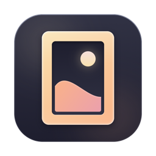
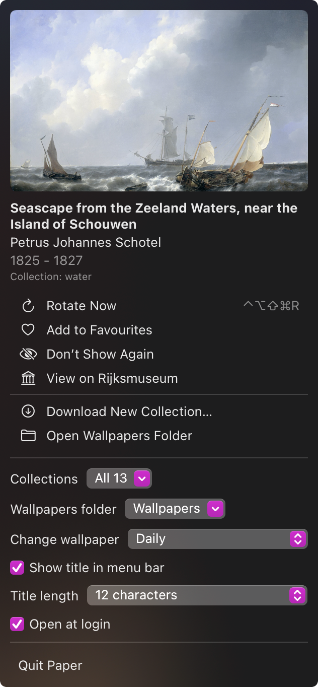

# Paper

**A museum on your desktop.**

Search for an artist, a place or a subject. Paper downloads the paintings 
from four museums and changes your wallpaper for you.

**[Download](../../releases/latest/download/Paper.zip)** &nbsp;·&nbsp; **[Guide](#guide)** &nbsp;·&nbsp; **[Report a problem](../../issues)**

| 1. Search | 2. Download | 3. Rotate | 4. Keep |
|:--|:--|:--|:--|
| Type an artist, a place or a subject. | Paintings are saved as a collection. | Your wallpaper changes every hour, every day, or when you say. | Favourites come up more often. Hide the ones you don't like. |

> [!NOTE]
> Tested on one Mac with Apple Silicon. It's built for Intel Macs too, but hasn't been tried on one.

## The paintings

- **Four museums:** the Met, the Rijksmuseum, the Art Institute of Chicago and the Cleveland Museum of Art. No account needed.
- **Public domain only**, going by what each museum says about the work.
- **Nothing twice.** Paintings already in your collections are skipped.
- **Landscape by default**, because it suits a screen. You can turn that off when you download.
- **No religious subjects.** Paper goes by the words in the museum's record, so it sometimes misses one or skips something it shouldn't.
- **From the Met**, only European paintings from 1400 to 1850.

## Install

Download **[Paper.zip](../../releases/latest/download/Paper.zip)**, unzip it, and drag **Paper.app** to Applications.

Paper isn't notarized by Apple, so macOS blocks the first launch:

1. Open Paper and click **Done** on the warning.
2. Go to **System Settings → Privacy & Security** and click **Open Anyway** beside Paper.
3. Open Paper again and click **Open**.

Paper then appears in your menu bar, at the top right of the screen.

## Guide

**Get some paintings.** Click Paper in the menu bar and choose **Download New Collection…**. Type something like *Venice*, *moonlight* or *Vermeer*, and click **Download**. If you have no wallpaper from Paper yet, the first one appears within about a minute.

**Every day.** Everything else is in the same menu.

| Menu | What it does |
|:--|:--|
| **Rotate Now** | Changes the wallpaper. <kbd>⌃⌥⇧⌘R</kbd> does the same from any app. |
| **Add to Favourites** | Makes a painting four times as likely to come up. |
| **Don’t Show Again** | Hides a painting. Bring hidden ones back from **Collections**. |
| **View on…** | Opens the painting on the museum's website. |
| **Collections** | Turns whole collections on or off. |
| **Wallpapers folder** | Keeps paintings somewhere other than Pictures → Wallpapers. Ones you already have stay where they are, but you can move them in Finder. |
| **Change wallpaper** | Every hour, 3 hours, 6 hours, every day, or never. |

**Remove it.** Turn off **Open at login**, choose **Quit Paper**, and drag Paper from Applications to the Bin. Your paintings stay in their folder until you delete them.

## Credits

Built by [JFlowerMedia](https://jflowermedia.com/)

Paintings come from the open collections of [The Met](https://www.metmuseum.org/), the [Rijksmuseum](https://www.rijksmuseum.nl/), the [Art Institute of Chicago](https://www.artic.edu/) and the [Cleveland Museum of Art](https://www.clevelandart.org/). Paper isn't affiliated with them.

The icon uses the [Catppuccin](https://github.com/catppuccin/catppuccin) palette, MIT. Paper is [MIT licensed](LICENSE).

Disclaimer

Paper is provided as is, without warranty. It relies on each museum's own record of what is in the public domain, and those can be wrong. Check the museum's website before reusing an image.

